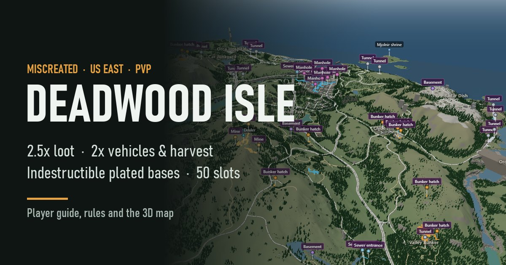

<!--
  For editors: the full player guide is the website home, index.html (the in-game welcome banner links to it through
  tinyurl.com/deadwoodisle). Put feature, rule and changelog updates there, and describe the LIVE server only.
  Keep this README short.
-->
# Deadwood Isle — a Miscreated server

**US East · PvP · 50 slots · Islands map** · 2.5x loot, 2x vehicles and harvest, indestructible plated bases.

## 👉 [Open the player guide](https://rudeboi1992.github.io/deadwood-isle/)

Everything about the server is on the website: what's different from vanilla, vendors and mystery crates, Mjolnir and Thor's trial, tuned cars, drones and the Pack Mule, the EMP-7 and taser, base power, farming and food, jobs and banking, missions and mailboxes, chat commands, rules and the changelog.

**[🗺️ Open the 3D map of the island →](https://rudeboi1992.github.io/deadwood-isle/docs/3d/)**

## Join

In the in-game server browser, search for **Deadwood** (listed as `NEW|US-East|Deadwood|2x Loot/Veh/Harvest|Indestructible Plated`). Steam downloads the three Workshop mods when you join: [Admin Chat Commands](https://steamcommunity.com/sharedfiles/filedetails/?id=2217434939), [BMW M4 & Charger Interceptor](https://steamcommunity.com/sharedfiles/filedetails/?id=2005194385) and [Deadwood Isle – Base Limits](https://steamcommunity.com/sharedfiles/filedetails/?id=3797893300).

## Rules

1. No cheating, exploiting or glitching through bases.
2. No hate speech in chat. Trash talk is fine; slurs get you banned.
3. Don't build inside or block spawn points, roads or loot buildings.
4. Admin decisions are final. Admins don't play favorites and don't spawn gear for anyone in normal play.

## Contact

Admin: **Toll Troll** on the server. Problems with the page or the server: [open an issue](https://github.com/rudeboi1992/deadwood-isle/issues).
