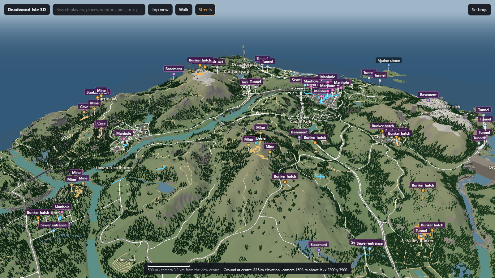
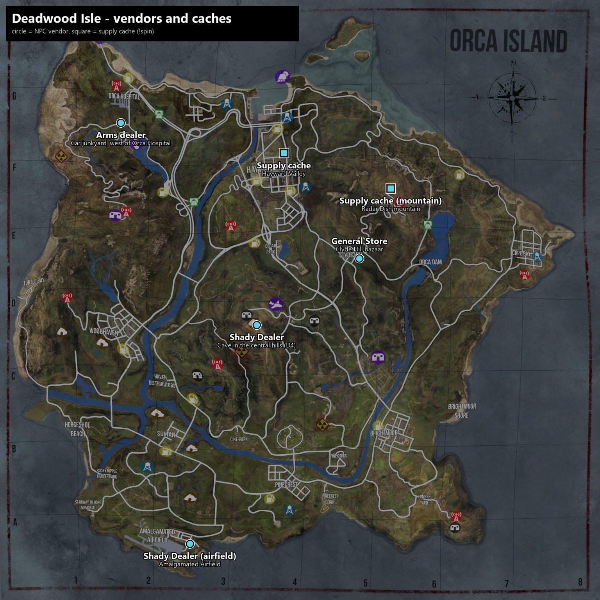

# Deadwood Isle — a Miscreated server

**US-East · PvP · 50 slots · Islands map**

| | |
|---|---|
| Find it | In the in-game server browser, search for **Deadwood** (listed as `NEW\|US-East\|Deadwood\|2x Loot/Veh/Harvest\|Indestructible Plated`) |
| Region | US East |
| Map | Islands |
| Players | 50 |
| Day/night | Stock (nights run 4x faster than days) |
| Mods required | [Admin Chat Commands](https://steamcommunity.com/sharedfiles/filedetails/?id=2217434939), [BMW M4 & Charger Interceptor](https://steamcommunity.com/sharedfiles/filedetails/?id=2005194385) (101 MB) and [Deadwood Isle – Base Limits](https://steamcommunity.com/sharedfiles/filedetails/?id=3797893300) (small) — all three download automatically when you join |

## 🗺️ 3D map of the island

**[Open the Deadwood Isle 3D map →](https://rudeboi1992.github.io/deadwood-isle/docs/3d/)**

The whole island in your browser, built from the game's own level files: terrain, every building and prop, roads, rivers and lakes, sewers, mines, tunnels and bunkers.

- **Look around** – drag to move, right-drag to turn, scroll to zoom. Tap anything to see what it is.
- **Walk it** – "Walk here" drops you in at eye level: W A S D to move, Space to jump, F to use ladders, G to fly.
- **Streets** – bold road and path lines like a paper map. **Settings** turns layers on and off and shows the underground passages through the ground.
- **Search** – places, vendors, entrances, or type coordinates as `x y`.

No player positions, vehicles or bases are shown here; that version lives on the server for admins.

## How this server differs from vanilla

You don't need to install anything except the Workshop mods, which Steam handles for you on join.

### Loot
- **2.5x loot.** 50% of item spawners are active (vanilla 20%) and the world holds up to 1,800 items at once (vanilla 750).
- **More guns and ammo.** In every loot table the weapon and ammo share is 1.5x vanilla, with the rest scaled down. Rare and epic weapons are untouched, so they stay rare.

### Vehicles
- **2x vehicles.** Every vehicle category spawns double the stock minimum, so more cars, trucks, boats and bikes on the map.
- **Parked vehicles last 14 days.** Vanilla deletes a vehicle nobody has used for 6 hours (bikes, quads, jet skis, tractors), 2 days (cars) or 3 days (trucks and buses). Here every vehicle keeps its spot for 14 days untouched before it despawns and respawns elsewhere.
- Abandoned vehicles respawn in 30 minutes instead of 60. Destroyed vehicles respawn in 1 hour instead of 2.
- **Charger Interceptor** added via the Workshop mod: police car spawns alternate between the stock cop cars and the Charger. Sedan spawns stay stock. The BMW M4 from the same mod does not spawn in the world; it's an admin-only event car.

### Harvesting
- **Bigger nodes.** Trees give 2x the logs (a full-size tree is 132 hits, vanilla 66). Rock and iron nodes give 4x (80 and 160 hits, vanilla 20 and 40). Coal and pyrite give 2x (80, vanilla 40). Scrap metal piles and regeneration timers are stock.
- **Hatchets never miss.** The hatchet and the crafted hatchet harvest on every swing (vanilla: 25% of swings give nothing). The game caps yield at one item per swing, so nothing on this server gives two per swing.
- **Hatchet is the fast tool, the axe is the steady one.** The hatchet swings every 0.9 s, as fast as its animation allows (vanilla 1.25 s). The axe keeps its vanilla 1.5 s rhythm with the pause between swings. The crafted hatchet is vanilla speed.
- **Tools last longer.** Axes and pickaxes wear a third slower: about 500 hits on wood or ore before they break, vanilla about 330.

### Base building
- **Wood is 2x tougher.** Every wood part has double health. Walls, foundations, roofs, stairs, walkways and ramps: 20,000 HP. Doors and shutters: 10,000. Gatehouses and watchtowers: 40,000.
- **Plated parts are indestructible.** Nothing damages them — not C4, not sledgehammers, not vehicles, not fire. Plate your walls and your base stays yours.
- Metal, rock and stone parts are stock.
- **Bigger bases.** Plot sign allows 600 parts (vanilla 250), a 50 m build radius (vanilla 30 m) and 40 m of vertical build room (vanilla 8.5 m), so tall builds and floating floors work.
- **Better generators.** The fuel generator runs 10 work lights (vanilla 5), the solar generator runs 30 (vanilla 3) and is silent.
- **Candles light without a lighter.** The Halloween candle, Christmas candle and jack-o'-lantern switch on and off like lanterns, no lighter or matches needed. Each also sells to vendors for 100.

### Vendors and amcoins
- **Most gear sells.** Vanilla vendors buy only a handful of items. Here they buy clothing, weapons, equipment, repair kits, consumables, magazines and tents. Prices follow rarity, so the rarer the drop the more it pays: Katana 150, Mk18 Reaver 200, AKM Gold 200, M249 150, VSS 100, sledgehammer 100, Patrick's axe 150. Base parts, traps and raw resources are deliberately unsellable.
- **Trophies pay.** Gold skull mask 100, silver skull mask 75, space helmet 250, chrome cross necklace 200, gold 100, silver 50.
- **Payouts up to 255.** A sale pays in full up to 255 coins, which is how many a ledger stack holds (vanilla capped payouts at 100). Nothing is priced above 255.
- The game's own sell rules still apply: the item must be undamaged, a full stack, and containers and magazines must be empty.

#### Where to trade

- **General Store** at the Clyde Hill bazaar carries a rotating selection of about 40 items drawn from every vendor list on the map: guns, ammo, food, crafting and clothing, plus the Shady Dealer's stock. The **Food vendor** is still at the bazaar.
- **Arms dealer** at the car junkyard west of Orca Hospital: common rifles, SMGs, shotguns and pistols with their mags and ammo.
- **Shady Dealer** in a cave in the central hills (grid D4), and a second one behind the shop counter at Amalgamated Airfield on the south island. Both sell the shady stock: AK-Val, AK5D, SAS12, ammo, armor, with a small chance of an M249 or M97.
- **Supply cache** at the crashed airplane building in Hayward Valley: an airdrop crate that trades like a vendor with the Shady Dealer's stock, and it runs a **mystery crate**.
- **Mountain cache** on the Radar Dish mountain, up the stairs on the platform marked by a skull candle. Same shady stock plus every magazine and ammo box for the prize guns. The ground around it is never empty: **15 mutants and 3 armored brutes** stand guard at all times and are replaced as they fall. It runs the **legendary crate**. The food vendor it replaced is covered by the General Store.

#### Mystery crate (Hayward Valley)
- Stand next to the supply cache and type `!spin`. It takes **100 amcoins** straight from your ledger and hands you one random rare item.
- 18 possible prizes, all worth 100 to 250 at the vendors: Katana, Black Widow, Patrick's Axe, Her Majesty, sledgehammer, M16 Vietnam, Mk18 Reaver, AKM Gold, RPK, VSS, M249, M97, Grimey Rick, rifle silencer, skull mask gold, gold and chrome cross necklaces, space helmet. `!spin odds` lists the chances.
- **Guns come with two full magazines.**

#### Legendary crate (mountain cache)
- `!spin` next to the mountain cache costs **50 amcoins** and only ever pays a gun, **fully kitted**: loaded magazine, scope, silencer, light, laser or grip where the gun takes them, plus **3 spare magazines**.
- Legendary 60%: The Dictator, The Reaver, M16 Vietnam, The Comrade, M249, VSS, Grimey Rick, M97 grenade launcher. Rare 40%: AT15, AK5D, M40A5, Vector, SAS12, MP5.

#### Both crates
- **2 spins per person per cache per day** (resets at midnight server time).
- Need a free weapon slot for a gun or melee prize and a free inventory slot for anything else. If there's no room, nothing is charged and the spin isn't counted.
- Prizes worth 200 or more are announced in chat.
- `!coins` shows your amcoin balance across all stacks in your inventory. A ledger stack holds 255; the game's inventory never shows more than that, so your real balance is the sum of your stacks.

### Gameplay
- **Prone is enabled.**
- **Halloween runs all autumn.** The Halloween event is forced on from October 1 to November 30: seasonal loot, candles and jack-o'-lanterns.
- **Welcome banner.** New arrivals get the server summary on screen for a minute; `!welcome` shows it again.

### Mjolnir and Thor's trial
Thor's hammer is on the island. Only a few exist at once, and only the worthy can hold one.

- **Moves:** *Valkyrie's Flight* (throw it: lightning where it lands, then it flies back to you), *Aesir Sweep* (throw it at your feet: a ground slam) and *Thor's Wrath* (throw it straight up: a storm). Mutants and animals it kills vanish in smoke. It never hurts its holder.
- **Dropped, it plants itself** where it falls and nobody else can lift it. Walk back to it, or, if your hammer came with a **Norse Medallion** (it's in your pack while the hammer is away), take the medallion in hand to call it home. Called home, it sets every mutant and animal around you on fire.
- **Legendary hammers have 100 charges** (a throw 1, a slam 5, a storm 10). Left planted for 4 days, or kept in a stash for a week, a hammer flies home.
- **Winning one:** a lucky spin at a supply cache, or **Thor's trial**. Find Mjolnir's shrine, step inside the ring of its guardians and you're handed *Thor's Challenge*: a scroll naming two offerings. Find **Thor's talisman** (the hint is in chat, and `!hint` repeats it), bring it and the offerings to the shrine, and the hammer is yours. The Allfather's ravens circle high above wherever the talisman waits. It only reveals itself to players carrying the scroll, and the first to bring everything back wins. Every time the shrine hammer breaks and flies home, a new trial begins somewhere else on the island.

<b>⚠️ SPOILERS: where the talismans are hidden. Opening this gives the hunt away.</b>

<b>Last warning.</b> The trial is meant to be solved from its hint. These are the exact places the talisman waits. Reading them spoils the hunt for you. If you only want a nudge, type <code>!hint</code> in game instead. Each place below is folded on its own, so you can open just one.

Spoiler: Mjolnir's shrine

On the north coast around <b>4771, 8032</b>, ringed by six armored brutes.

Spoiler: "I pray you find it."

One of the three churches, chosen at random each time this trial comes round: <b>Sultan</b> (2397, 2222), <b>Hayward</b> (3978, 6672) or <b>Cape Bay</b> (7060, 4980). Inside the church.

Spoiler: "Do not give up hope on your quest…"

The <b>Stairway to Hope</b>, at the top, around <b>1080, 990</b> (height 74).

Spoiler: "Hope climbs the stairs, but its secret sleeps in the dark beneath them."

The cave under the Stairway to Hope, around <b>1072, 1049</b> (height 27).

Spoiler: "Clear out the shelter by the lumber yard…"

The bunker by the lumber yard in the far south-east, around <b>6363, 956</b>. It's full of mutants; the talisman appears in the middle once every one of them is dead.

Spoiler: "…the bridge of life and take the leap of faith."

Under the <b>Broken Bridge</b>: jump, then swim back. It's on the rocks right below the bridge, around <b>1248, 7950</b> (height 17).

Spoiler: "…where floodwaters are held at bay… a watery grave."

At the foot of <b>Orca Dam</b>, between the two pillars, under the water by the graves, around <b>5904, 4702</b>. Thor's blessing keeps you from drowning there, and taking the talisman carries you out.

### Chat commands for everyone
- `!thor` explains how Mjolnir works; `!hint` repeats the current trial's hint; `!mjolnir charges` shows a legendary hammer's charges.
- `!corpse` lists the coordinates of your nearest bodies so you can go get your gear back.
- `!pos` prints your coordinates and compass heading.
- `!welcome` shows the welcome banner again.
- `!spin` opens a mystery crate at a supply cache (100 amcoins at Hayward, 50 at the mountain, 2 a day each); `!spin odds` lists the prizes of the cache you're standing at.
- `!coins` shows your amcoin balance across all stacks in your inventory.

### Base part HP at a glance

| Part | Vanilla | Here |
|---|---|---|
| Wood wall 3x4 / foundation / roof / stairs / walkway | 10,000 | **20,000** |
| Wood door, shutter, trapdoor | 5,000 | **10,000** |
| Wood gatehouse, watchtower, gallows | 20,000 | **40,000** |
| Plated anything | 22,500 | **cannot be damaged** |
| Metal wall / gate / gatehouse | 37,500 | 37,500 |
| Rock foundation | 22,500 | 22,500 |

Sledgehammer 60 per hit, pickaxe/axe 30, hatchet 22. Wood takes full damage from any tool; only explosives and sledgehammers hurt plated in vanilla, and here nothing does.

### Raiding, for reference
- Stock plated wall: ~113 sledgehammer hits (about 4 minutes solo). Here: cannot be broken.
- A 20,000 HP wood wall takes ~334 sledgehammer hits or ~667 pickaxe hits. Explosives still work on wood.

## Rules
1. No cheating, exploiting or glitching through bases.
2. No hate speech in chat. Trash talk is fine; slurs get you banned.
3. Don't build inside or block spawn points, roads or loot buildings.
4. **Two vehicles per base, maximum.** Extras get removed.
5. Admin decisions are final. Admins don't play favorites and don't spawn gear for anyone in normal play.

## Wipes
No schedule. The world wipes only when base clutter hurts performance or new players can't find room, or when a game update forces it. Wipes are announced in the join message at least a few days ahead.

## Known quirks
- **Big vehicles and part swaps.** The game's anti-cheat measures reach to the vehicle's center. On the 5-ton and bus, crouch against the middle of the vehicle's side before swapping wheels or parts, or the server rejects the move.
- The server restarts once a day at 5 AM Eastern, with in-game warnings beforehand. Bodies and dropped items don't survive a restart; bases, vehicles and your inventory do.

## Contact
Admin: **Toll Troll** on the server. Issues with this page or the server: [open an issue on this repo](https://github.com/rudeboi1992/deadwood-isle/issues).

## Changelog
- **2026-10-24** — Mjolnir and Thor's trial: legendary hammers (100 charges) from the supply-cache spins and from Mjolnir's shrine, the Norse Medallion, six rotating talisman hunts with Thor's Challenge scrolls, `!thor` and `!hint`.
- **2026-10-20 (later)** — Mountain cache on the Radar Dish mountain: shady stock plus ammo, the 50-coin legendary crate (kitted guns, 3 mags), guarded by 15 mutants and 3 armored brutes around the clock. Food vendor retired from the bazaar.
- **2026-10-20** — Mystery crate at the new Hayward Valley supply cache (`!spin`, 100 amcoins, 2 a day, guns come with two mags). Second Shady Dealer at Amalgamated Airfield. Crafting and clothing vendors removed from the bazaar (the General Store covers both). Amcoin stacks hold 255 and sales pay up to 255; space helmet now 250. `!coins`. Vendor map added to this page.
- **2026-10-19** — Halloween and Christmas candles and jack-o'-lanterns light without a lighter and sell for 100; on-screen welcome banner and `!welcome`; two-vehicles-per-base rule.
- **2026-10-18** — Vendors buy most gear at rarity-based prices, trophies included, and the 100-coin payout cap is gone. General Store at the bazaar sells a bit of everything; arms dealer moved to the car junkyard; Shady Dealer moved out of the sewer. Hatchet swings 0.9 s and the axe is back to its vanilla 1.5 s; axes and pickaxes wear slower; rock and iron nodes 4x, coal and pyrite 2x. `!pos` for everyone.
- **2026-10-04** — Daily restart moved to 5 AM Eastern.
- **2026-09-19** — Parked vehicles last 14 days before despawning.
- **2026-09-10** — Axe swings 0.9 s (hatchet 1.25 s); Base Limits mod v7 carries the tool definitions. *(Reversed on 2026-10-18.)*
- **2026-09-09** — `!corpse` for everyone; light-switch investigation closed (no master switch in the game).
- **2026-09-08** — Loot 2.5x with 1.5x weapon/ammo share; plot sign 600 parts / 50 m / 40 m; generators 10 and 30 lights, solar silent; prone enabled; Base Limits Workshop mod.
- **2026-09-07** — 2x harvest, axe/hatchet rebalance, admin commands mod, BMW & Charger mod (Charger in police spawns), "NEW" tag.
- **2026-09-06** — 2x loot, 2x vehicles, wood 2x HP, indestructible plated, server renamed to Deadwood Isle, 50 slots.
- **2026-09-05** — Server launched.

